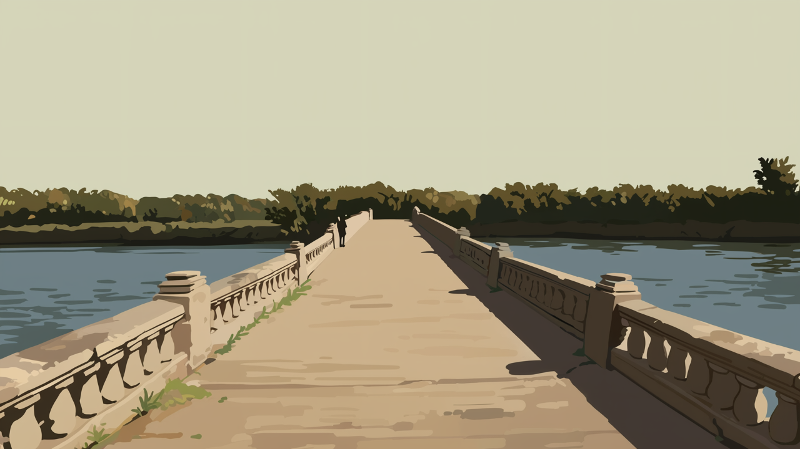
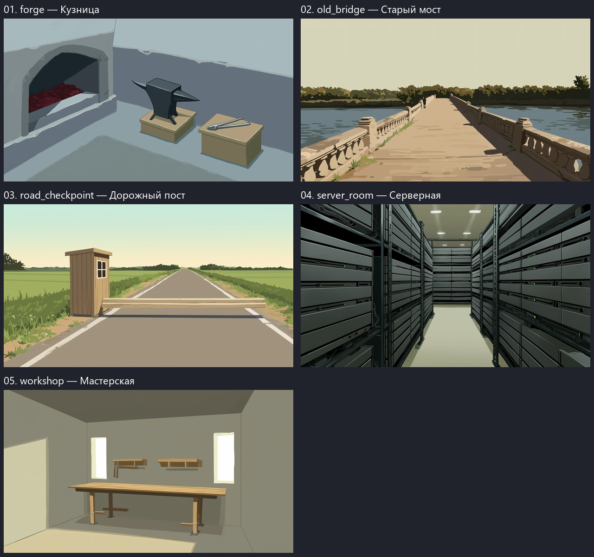

# Проверка фонов — 15 октября 2026, вторая попытка

Просмотрены все 5 новых PNG 1280×720 из `run_regen_ef0def16ab61a1ee`. Установлены все 5 замен: кузница, мастерская, серверная, дорожный пост и мост. Фигура на мосту оставлена по решению пользователя.

В игре 80 локаций + отдельная заглушка. Обязательных перегенераций не осталось; 17 пригодных фонов можно улучшить по желанию. В предыдущем проходе были приняты 11 замен и заглушка; история отбора сохранена в REVIEW.json.

Принятые PNG/JSON заменены в `assets/backgrounds/originals`, игровые WebP — в `backend/backgrounds`; обновлены SHA-256 и привязки профилей эффектов. Режимы света сохранены. Резервные копии старых файлов сохранены вне игрового набора.

## Установлены в этом проходе

| ID | Локация | Оценка |
|---|---|---|
| `forge` | Кузница | Пригодная упрощённая кузница: отдельные горн с углями и наковальня, огня на наковальне больше нет. Можно улучшить пропорции опоры и добавить один-два узнаваемых инструмента. |
| `workshop` | Мастерская | Исправлен прежний дефект; фон пригоден для игры. |
| `server_room` | Серверная | Исправлен прежний дефект; фон пригоден для игры. |
| `road_checkpoint` | Дорожный пост | Пост читается: отдельная будка и шлагбаум над открытой дорогой. Асфальт и белые краевые линии привязывают рисунок к современной эпохе; для большей универсальности можно заменить дорогу грунтовой. |

| `old_bridge` | Старый мост | Установлен по решению пользователя; фигура вдали допустима. |

## Обязательная перегенерация

Не требуется.

## Необязательные улучшения

Эти фоны пригодны; срочная замена не требуется.

| ID | Локация | Что можно улучшить |
|---|---|---|
| `country_road` | Грунтовая дорога | На горизонте есть столбы с проводами: снижают универсальность по эпохам. |
| `sandy_beach` | Песчаный пляж | Крупные прямые швы на переднем плане читаются как мощение, а не песок. |
| `mountain_pass` | Горный перевал | Композиция больше похожа на мощёный проход между каменными стенами, чем на горный перевал. |
| `camp` | Походный лагерь | Палатка стоит в окружении высоких ровных бежевых стен; хотелось бы открытый лагерь среди природы. |
| `settlement_street` | Улица поселения | Электрические столбы, провода и узнаваемые крыши привязывают улицу к определённой эпохе и региону. |
| `narrow_alley` | Узкий переулок | Похоже на тупиковый двор с двумя дверями; узкий переулок лучше показать уходящим вдаль. |
| `harbor_quay` | Причал | Почти весь кадр занимает пустое светлое небо, причал прижат к нижней части; стоит поднять горизонт и дать больше настила. |
| `living_small` | Жилая комната | Комната показана через большую раму/проём, мебель слишком далеко; лучше расположить камеру внутри. |
| `forge` | Кузница | Пригодная упрощённая кузница: отдельные горн с углями и наковальня, огня на наковальне больше нет. Можно улучшить пропорции опоры и добавить один-два узнаваемых инструмента. |
| `mine` | Шахта | Теперь полноценный интерьер на весь кадр. Шахтных признаков мало: добавить несколько крепей и более читаемую вагонетку; светлый дальний участок не должен выглядеть солнечным выходом. |
| `underground_tunnel` | Подземный технический тоннель | Теперь закрытый проход вместо открытого двора. Для большей узнаваемости технического тоннеля можно добавить несколько простых труб и ламп; сейчас почти пустые стены. |
| `ship_cabin` | Корабельная каюта | Искривлённые стены и огромные окна делают комнату похожей на транспортную капсулу; корабельные признаки слабы. |
| `rooftop` | Крыша здания | Очень пустой участок с высокими парапетами; недостаточно признаков высоты и окружающих крыш. |
| `road_checkpoint` | Дорожный пост | Пост читается: отдельная будка и шлагбаум над открытой дорогой. Асфальт и белые краевые линии привязывают рисунок к современной эпохе; для большей универсальности можно заменить дорогу грунтовой. |
| `carriage_interior` | Конная повозка | Рабочий упрощённый интерьер без интерфейса и животных. Передняя лавка слабо связана с корпусом повозки; при следующем улучшении яснее показать место кучера и переднюю площадку. |
| `future_city` | Футуристическая улица | Видна преимущественно глухая изогнутая стена с экранами; городской масштаб и улица читаются слабо. |
| `alien_planet` | Поверхность чужой планеты | Рабочий пустынный пейзаж, но очень земной: для уникальной планеты стоит добавить один простой необычный природный признак. |

## Все новые варианты второй попытки

